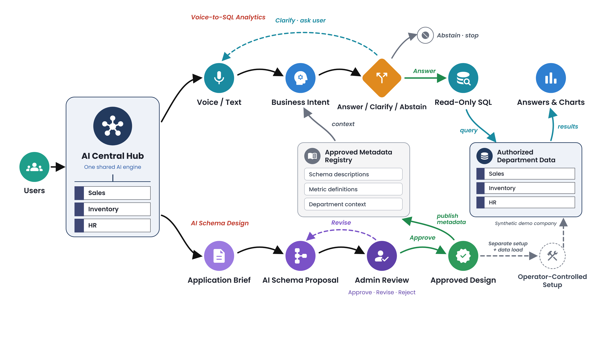

# ClearQuery: Ambiguity-Aware Voice-to-SQL in Egyptian Arabic

**Misr International University (MIU) · Software Engineering graduation project · V3.1 team-approved planning baseline**

| Item | Status (24 October 2026) |
|---|---|
| Official title: *ClearQuery: Ambiguity-Aware Voice-to-SQL in Egyptian Arabic* | **TA approved** (D-33, recorded 24 Oct 2026; replaces *Voice-to-SQL in Egyptian Arabic*, D-29) |
| Abstract | **Student-confirmed final** |
| Six registration form fields | **Finalized** |
| University registration | **NOT SUBMITTED** |
| Formal committee approval of the expanded V3.1 scope | **Not obtained** |
| Implementation | **NOT STARTED** |
| Custom datasets and recordings | **PLANNED, not collected** (dataset generation NOT STARTED) |
| Evaluation | **NOT STARTED** (no results exist) |

Details and approvals: [PROJECT_STATUS.md](PROJECT_STATUS.md).

> This **private** repository currently holds **planning documentation only**: the approved V3.1 specification, architecture, dataset strategy, evaluation plan, final registration-form text and the approved system-overview diagram. It contains no source code, no data, no recordings and no results. Nothing described here should be read as implemented, collected, measured or committee-approved.

## Abstract

The final, student-approved Abstract (213 words; TA-approved revised short Abstract, as reported by the student). It is reproduced **verbatim** and must not be rewritten, shortened, expanded or translated.

<!-- BEGIN VERBATIM ABSTRACT source="Form Field 2" sha256="00a3a29930ee0382c511fd59cb7df89b76ecb5e13dabe75386546ed9ab80bba0" (hash of the text without its final newline) -->
Managers in small and medium-sized organizations often need quick answers from business databases but depend on technical staff to write SQL queries. However, ambiguous Egyptian-Arabic business questions can cause silent semantic errors, where a technically valid SQL query returns a business answer that does not match the user’s intended meaning.

This project proposes an AI Central Hub for one synthetic demonstration company with three functional, separately authorized workspaces: Sales, Inventory and Human Resources. Users will ask typed or spoken Egyptian-Arabic questions; the system will convert each question into a structured Business Intent Representation grounded in an approved departmental catalog, detect material ambiguity or missing data, and select one of three decisions (Answer, Clarify or Abstain) before generating guarded, read-only SQL whose results come directly from the database.

A second mode will help developers turn incomplete application requirements into proposed relational schemas with explicit assumptions and open questions for human Admin review; approval will not execute database changes.

The primary evaluation will compare this ambiguity-aware approach with a strong, clarification-enabled LLM baseline under matched data and context, measuring business-answer accuracy, silent errors, clarification quality and risk–coverage trade-offs for voice and text questions. Verification will test SQL safety, cross-department access control and the review workflow, while schema proposals will be assessed separately by independent reviewers.
<!-- END VERBATIM ABSTRACT -->

## High-Level System Overview



*v6, approved by the project team (22 Oct 2026) and the academic supervisor (recorded 23 Oct 2026). Not a university committee approval of the expanded scope. The image is kept byte-identical and must not be redesigned or replaced.*

## V3.1 scope in brief

One **AI Central Hub** for a single, explicitly **synthetic** demonstration company, with two complementary modes. The authoritative wording is Form Field 3 in [docs/REGISTRATION_FORM_FIELDS.md](docs/REGISTRATION_FORM_FIELDS.md) and [docs/SPECIFICATION.md](docs/SPECIFICATION.md) §5.

**Mandatory MVP (planned):**

- **Three functional, separately authorized workspaces: Sales, Inventory and HR.** They share one analytics engine but use department-specific schemas, approved metric catalogs and permissions.
  - **Sales** is the primary research domain (P2-vs-P4 study).
  - **Inventory** covers stock levels, stock movements and reorder thresholds, and hosts the integrated Schema Design → Admin → operator provisioning → analytics scenario.
  - **HR** covers headcount and leave analytics on **invented records only**, with typed and spoken questions and cross-department access denial. It is not an HR management or payroll system.
- **Egyptian-Arabic voice and text questions** with an editable, user-confirmed speech transcript.
- **Ambiguity-aware selective answering:** Business Intent Representation (BIR) grounded in the approved catalog, ambiguity detection on the **original Arabic**, and a deterministic **Answer / Clarify / Abstain** decision with at most one clarification turn, all **before any SQL**.
- **English-to-SQL pipeline (TA-clarified):** an ambiguity-preserving Arabic-to-English translation (derived and audited, never authoritative) feeds English question-to-SQL generation, which runs **only after an Answer decision**.
- **Safe, read-only SQL:** a single SELECT over authorized views, AST/allowlist checks, server-side department authorization, BIR↔SQL consistency checks and a least-privilege read-only database role. Clarify and Abstain execute no SQL. Numbers come from PostgreSQL, not from the model.
- **AI Schema Design with Admin approval:** a developer submits incomplete requirements and receives proposed tables, attributes, keys, relationships, assumptions and open questions. An Admin approves, revises or rejects versioned drafts. **Approval publishes metadata only and never executes DDL**; any database setup is a separate, operator-controlled step in an isolated demo environment.
- Authentication, server-side department authorization and audit logging.

**Excluded from the MVP:** complete ERP, HR or payroll systems; automatic production DDL; autonomous application generation; real personal data; multi-company deployment; live ERP/POS connectors; training or fine-tuning foundation models.

## Analytics pipeline (normative order: SPECIFICATION.md §8.1)

**Egyptian-Arabic Voice → Arabic Text → English Text → English-to-SQL, with Arabic-anchored ambiguity checking:** the confirmed Arabic text stays authoritative for intent, ambiguity detection and the Answer / Clarify / Abstain decision; the English text is a derived, ambiguity-preserving translation used for SQL generation only after an Answer decision.

```text
Egyptian-Arabic voice or text
  -> authorization gate (server; DENY before any model call)
  -> speech-to-text -> editable, user-confirmed Arabic transcript (q_ar, authoritative)
  -> BIR + ambiguity detection on q_ar with the workspace's approved catalog
  -> deterministic decision: Answer | Clarify (max 1 turn, no SQL) | Abstain (no SQL)
       (in parallel: q_ar -> ambiguity-preserving Arabic-to-English translation q_en -> audit only)
  -> Answer only: English question-to-SQL from q_en + resolved BIR (BIR wins on conflict)
  -> guards: AST, allowlist, department authorization, BIR<->SQL consistency
  -> read-only execution -> result, chart, interpretation and SQL trace
```

## Repository map

| Path | Contents |
|---|---|
| [PROJECT_STATUS.md](PROJECT_STATUS.md) | Current status, approvals and their limits, open decisions, next steps |
| [PROJECT_EVOLUTION.md](PROJECT_EVOLUTION.md) | How the project evolved from the original concept through V2 and V3 to V3.1, with the decision index |
| [AGENTS.md](AGENTS.md) | Rules for AI agents and contributors (read before changing anything) |
| [CLAUDE.md](CLAUDE.md) | Claude Code entry point (imports AGENTS.md) |
| [CONTRIBUTING.md](CONTRIBUTING.md) | Team workflow: feature branch → pull request → human code review → merge; rules for AI coding agents |
| [.github/pull_request_template.md](.github/pull_request_template.md) | Pull request checklist: scope, testing, documentation, security and data, AI assistance disclosure |
| [docs/README.md](docs/README.md) | Documentation index, provenance (SHA-256) and package path map |
| [docs/CHANGE_RECORD_D-31.md](docs/CHANGE_RECORD_D-31.md) | D-31 repository corrections, every edit with before/after text |
| [docs/CHANGE_RECORD_D-32.md](docs/CHANGE_RECORD_D-32.md) | D-32 private GitHub repository creation and its verification |
| [docs/CHANGE_RECORD_D-33.md](docs/CHANGE_RECORD_D-33.md) | D-33 TA-approved official title update, every edit with before/after text |
| [docs/CHANGE_RECORD_D-34.md](docs/CHANGE_RECORD_D-34.md) | D-34 current GitHub collaborator status (active vs pending) |
| [docs/CHANGE_RECORD_D-35.md](docs/CHANGE_RECORD_D-35.md) | D-35 branch protection on `main` (configured, API-verified, enforcement not yet tested) and team workflow |
| [docs/SPECIFICATION.md](docs/SPECIFICATION.md) | **Canonical V3.1 specification (source of truth)** |
| [docs/ARCHITECTURE.md](docs/ARCHITECTURE.md) | Architecture, demonstration contract and read-only/Admin governance contract |
| [docs/DATASET_STRATEGY.md](docs/DATASET_STRATEGY.md) | Team-approved dataset strategy (DS-1–DS-8, DS-11) |
| [docs/EVALUATION_PLAN.md](docs/EVALUATION_PLAN.md) | Evaluation plan: tracks, metrics, fairness and leakage controls |
| [docs/REGISTRATION_FORM_FIELDS.md](docs/REGISTRATION_FORM_FIELDS.md) | Final text of the six registration-form fields (not submitted) |
| [assets/System-Overview-3840x2160-v6.png](assets/System-Overview-3840x2160-v6.png) | Approved high-level system overview (3840 × 2160) |

## Research positioning

The project does **not** claim novelty for Text-to-SQL, AI schema generation, semantic layers, natural-language interfaces or question clarification in general; competitors such as Wren AI, Databricks Genie, Power BI Copilot, Power Apps Copilot and dbdiagram AI already cover parts of this space. The claim under test is narrower: whether explicit, Arabic-anchored business-intent modeling with selective answering reduces silent business-semantic errors in Egyptian-Arabic voice and text questions, compared fairly against a strong clarification-enabled baseline (SPECIFICATION.md §3, §16).

## License, ownership and third-party data

- **No license is granted.** The repository is private by design, and licensing and ownership of the project materials are **undecided**. Until the team decides, no permission to use, copy, modify or distribute these materials is given.
- **Third-party datasets** (Spider, BIRD Mini-Dev, Gretel, AraSpider, Casablanca, UCI Online Retail II, Contoso and the research benchmarks named in the docs) are **referenced only**. None of them is included in or redistributed through this repository, and the project claims no ownership of them or redistribution rights over them. Each keeps its own license and terms (docs/DATASET_STRATEGY.md §11).
